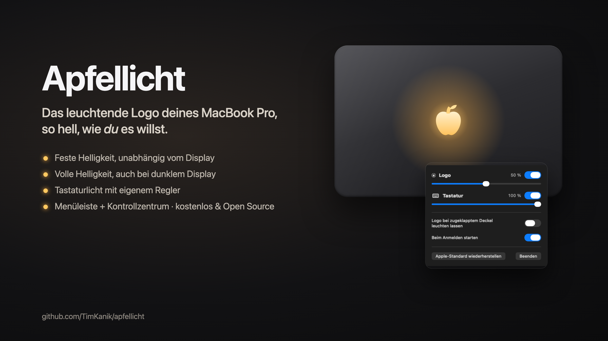
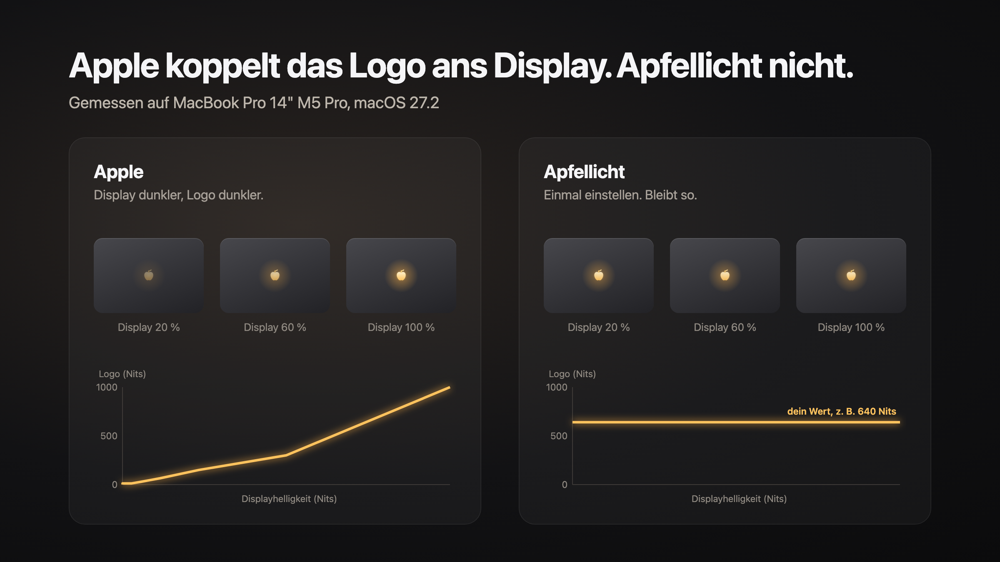
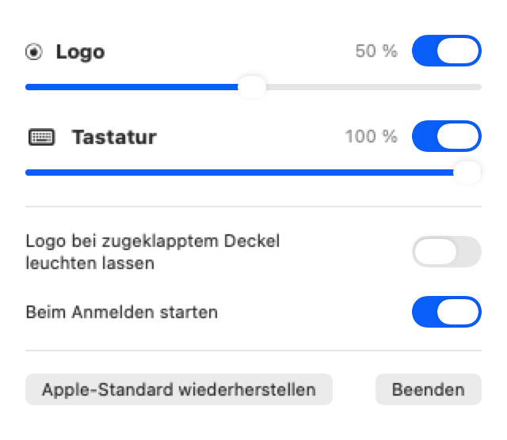

# Apfellicht

**Das leuchtende Logo deines MacBook Pro, so hell, wie du es willst.**

[English](README.md) · [Download](https://github.com/TimKanik/apfellicht/releases/latest) · MIT-Lizenz



Das neue MacBook Pro mit PROLED-XDR-Display hat wieder ein leuchtendes Logo auf dem Deckel. Apple koppelt dessen
Helligkeit an den Bildschirm: Dimmst du das Display, wird auch das Logo dunkler. Mit Apfellicht stellst du die
Helligkeit einmal selbst ein, und sie bleibt so.

- **Feste Logo-Helligkeit**, unabhängig von Displayhelligkeit und Umgebungslicht
- **Volle Helligkeit auch bei dunklem Display** (bei Apple wird das Logo nur bei sehr hellem Display so hell)
- **Tastaturlicht mit eigenem Regler**, unberührt von allem, was das Logo macht
- **Logo leuchtet auf Wunsch auch bei zugeklapptem Deckel** (mit externem Monitor)
- **Menüleisten-App plus Schalter im Kontrollzentrum** für Logo und Tastatur
- Kein Root, kein Passwort, kein Netzwerkzugriff. Kostenlos und Open Source.



## Voraussetzungen

- MacBook Pro mit PROLED-XDR-Display (die Modelle von 2026 mit leuchtendem Logo)
- macOS 26 oder neuer
- Getestet auf MacBook Pro 14" M5 Pro mit macOS 27.2. Andere Modelle sollten laufen. Wenn deins nicht läuft (oder
  doch), [eröffne bitte ein Issue](https://github.com/TimKanik/apfellicht/issues/new?template=bug_report.yml).

## Installation

### Weg 1: mit Claude Code (empfohlen)

Füge das in [Claude Code](https://claude.com/claude-code) ein:

```text
Klon https://github.com/TimKanik/apfellicht, lies die README und installier die App mit `make install`.
Dafür ist Xcode 26 oder neuer nötig; sag mir, falls es fehlt.
```

### Weg 2: im Terminal

Braucht Xcode 26 oder neuer.

```sh
git clone https://github.com/TimKanik/apfellicht.git
cd apfellicht
make install
```

Die App wird auf deinem Mac aus dem Code gebaut, den du gerade heruntergeladen hast. macOS öffnet sie deshalb ohne
Warnung.

### Weg 3: App herunterladen

1. Lade `Apfellicht.zip` aus dem [neuesten Release](https://github.com/TimKanik/apfellicht/releases/latest) und
   doppelklicke die Datei.
2. Zieh `Apfellicht.app` in deinen Ordner **Programme**.
3. Doppelklicke die App. macOS zeigt **„Apfellicht“ nicht geöffnet**. Klicke auf **Fertig**.
4. Öffne **Systemeinstellungen → Datenschutz & Sicherheit**, scrolle nach unten zu **Sicherheit** und klicke bei
   *„Apfellicht“ wurde blockiert* auf **Dennoch öffnen**. Bestätige mit Touch ID oder deinem Passwort.
5. Apfellicht erscheint in der Menüleiste. Fertig, macOS merkt sich die Entscheidung.

<details>
<summary>Schritt 3 und 4 lieber im Terminal?</summary>

```sh
xattr -dr com.apple.quarantine /Applications/Apfellicht.app && open /Applications/Apfellicht.app
```
</details>

#### Warum warnt macOS, und warum kannst du die App trotzdem sicher öffnen?

macOS zeigt diese Warnung bei jeder App, die nicht mit einer kostenpflichtigen Developer ID von Apple (99 $ im Jahr)
signiert ist. Sie heißt nicht, dass in der App etwas gefunden wurde. Sie heißt nur, dass Apple sie nicht geprüft hat.
So kannst du selbst prüfen:

- **Der gesamte Code liegt in diesem Repository.** Die App ist klein, etwa 1.000 Zeilen Swift.
- **Den Download baut GitHub, nicht mein Rechner.** Der [Release-Workflow](.github/workflows/release.yml) baut die
  ZIP auf GitHubs Servern aus dem getaggten Code. Zu jedem Release gibt es eine signierte
  [Build-Attestation](https://docs.github.com/de/actions/security-for-github-actions/using-artifact-attestations).
  Damit prüfst du, dass deine ZIP genau aus diesem Code stammt:
  ```sh
  gh attestation verify Apfellicht.zip --repo TimKanik/apfellicht
  ```
  Außerdem steht bei jedem Release die SHA-256-Prüfsumme der Datei (`shasum -a 256 Apfellicht.zip`).
- **Sie verlangt nichts.** Kein Administrator-Passwort, kein Root-Helfer, kein Netzwerkzugriff, keine Berechtigung
  für Bedienungshilfen oder Bildschirmaufnahme. Sie spricht nur mit dem Helligkeitsdienst von macOS.
- **Trotzdem unsicher?** Nimm Weg 1 oder 2. Dann baust du die App selbst aus dem Code.

## Bedienung

Klick auf den Apfel in der Menüleiste:



| | |
|---|---|
| **Logo** | Schalter und Regler. Der Wert bleibt fest, egal was Display oder Raumlicht machen. |
| **Tastatur** | Eigener Schalter und Regler. Die Helligkeitstasten der Tastatur funktionieren weiter und bewegen den Regler mit. |
| **Logo bei zugeklapptem Deckel leuchten lassen** | Mit angeschlossenem externem Monitor bleibt das Logo an, wenn du den Deckel schließt. |
| **Beim Anmelden starten** | Standardmäßig an. |
| **Apple-Standard wiederherstellen** | Gibt das Logo an Apples Automatik zurück. Bewege den Logo-Regler, um wieder zu übernehmen. |

**Kontrollzentrum:** Kontrollzentrum öffnen, *Steuerelemente bearbeiten* klicken und **Logo-Licht** und
**Tastaturlicht** hinzufügen.

Wenn das Display schläft, gehen Logo und Tastatur aus wie gewohnt. Beendest du Apfellicht, bleiben deine Werte bis zum
nächsten Neustart. Startet die App beim Anmelden, setzt sie sie wieder.

## Gut zu wissen

- **Werte unter etwa 150 Nits** (rund 40 % am Regler) greifen ganz, sobald der Lichtsensor den nächsten Wechsel im
  Raumlicht meldet. Meist dauert das Sekunden bis Minuten. Bis dahin zeigt das Menü einen Hinweis.
- **Deinstallieren:** *Apple-Standard wiederherstellen* klicken, Apfellicht beenden und aus Programme löschen.
- **Hängt etwas?** Im Projektordner setzt `make reset` Apples Tabellen zurück, `make status` zeigt, was macOS gerade
  rechnet.

## So funktioniert es

Das Logo steuert `corebrightnessd`, der Helligkeitsdienst von macOS. Er rechnet die Displayhelligkeit über eine Tabelle
in die Logo-Helligkeit um und begrenzt das Ergebnis nach dem Raumlicht. Apfellicht ersetzt diese Tabellen durch flache.
Jede Displayhelligkeit und jedes Raumlicht ergibt dann deinen Wert. Die Überblendung, die sich Tastatur und Logo teilen,
fasst Apfellicht nicht an, deshalb bleibt die Tastatur unberührt.

Das alles nutzt private, undokumentierte Schnittstellen von macOS und kann mit einem macOS-Update kaputtgehen. Details
und Messungen: [docs/research.md](docs/research.md) (Englisch).

## Bauen

```sh
make build     # Debug-Build
make app       # build/Apfellicht.app (signiert mit deiner Apple-Development-Identität, falls vorhanden, sonst ad hoc)
make install   # bauen, nach Programme kopieren und öffnen
```

## Danke

Die Forschung zu `corebrightnessd` baut auf [LogoLight](https://github.com/Ark0N/LogoLight) von Ark0N (MIT) auf. Von
dort stammt auch, wie man eine Kontrollzentrum-Erweiterung ohne Xcode-Projekt baut. Siehe
[docs/LICENSE-LogoLight.txt](docs/LICENSE-LogoLight.txt).

Nicht mit Apple Inc. verbunden. MacBook Pro ist eine Marke von Apple Inc.

## Lizenz

[MIT](LICENSE)
