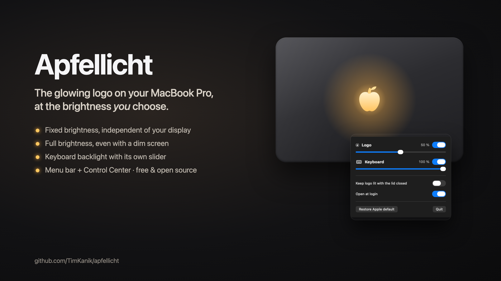
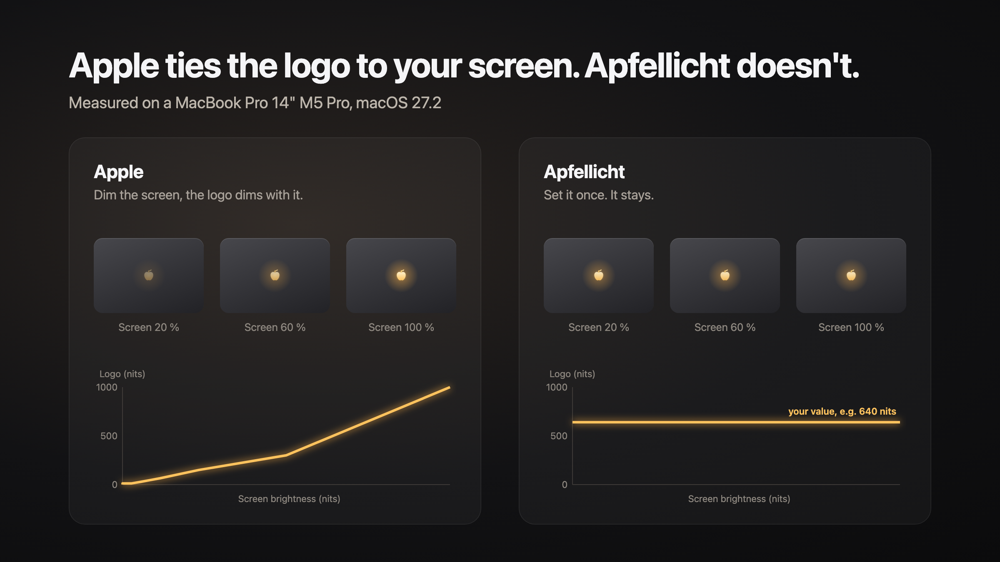
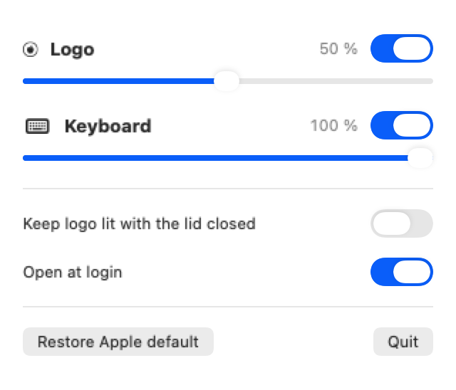

# Apfellicht

**The glowing logo on your MacBook Pro, at the brightness you choose.**

[Deutsch](README.de.md) · [Download](https://github.com/TimKanik/apfellicht/releases/latest) · MIT licensed



The new MacBook Pro with PROLED XDR display has an illuminated logo on the lid again. Apple ties its brightness to your
screen: dim the display and the logo dims with it. Apfellicht lets you set it yourself, once, and it stays that way.

- **Fixed logo brightness**, independent of your screen brightness and the room light
- **Full brightness even with a dim screen** (Apple only lets it get that bright when the screen is very bright)
- **Keyboard backlight with its own slider**, not touched by anything the logo does
- **Logo stays lit with the lid closed** if you want (with an external display)
- **Menu bar app plus Control Center switches** for logo and keyboard
- No root, no password, no network access. Free and open source.



## Requirements

- MacBook Pro with PROLED XDR display (the 2026 models with the illuminated logo)
- macOS 26 or later
- Tested on MacBook Pro 14" M5 Pro, macOS 27.2. Other models should work. If yours doesn't (or does), please
  [open an issue](https://github.com/TimKanik/apfellicht/issues/new?template=bug_report.yml).

## Install

### Option 1: with Claude Code (recommended)

Paste this into [Claude Code](https://claude.com/claude-code):

```text
Clone https://github.com/TimKanik/apfellicht, read the README and install the app with `make install`.
Xcode 26 or later is required; tell me if it's missing.
```

### Option 2: in Terminal

Needs Xcode 26 or later.

```sh
git clone https://github.com/TimKanik/apfellicht.git
cd apfellicht
make install
```

The app is built on your Mac from the source you just downloaded, so macOS opens it without any warning.

### Option 3: download the app

1. Download `Apfellicht.zip` from the [latest release](https://github.com/TimKanik/apfellicht/releases/latest) and
   double-click it.
2. Drag `Apfellicht.app` into your **Applications** folder.
3. Double-click it. macOS shows **"Apfellicht" Not Opened**. Click **Done**.
4. Open **System Settings → Privacy & Security**, scroll down to **Security** and click **Open Anyway** next to
   *"Apfellicht" was blocked*. Confirm with Touch ID or your password.
5. Apfellicht appears in the menu bar. That's it, macOS remembers your choice.

<details>
<summary>Prefer Terminal for steps 3 and 4?</summary>

```sh
xattr -dr com.apple.quarantine /Applications/Apfellicht.app && open /Applications/Apfellicht.app
```
</details>

#### Why does macOS warn, and why is it safe to open?

macOS shows this warning for every app that isn't signed with a paid Apple Developer ID ($99 a year). It doesn't
mean anything was found in the app. It only means Apple hasn't checked it. Here is how you can check it yourself:

- **All of the code is in this repository.** The app is small (about 1,000 lines of Swift).
- **The download is built by GitHub, not on my computer.** The [release workflow](.github/workflows/release.yml)
  builds the ZIP from the tagged source on GitHub's servers. Each release comes with a signed
  [build attestation](https://docs.github.com/actions/security-for-github-actions/using-artifact-attestations),
  so you can verify that your ZIP came out of exactly this code:
  ```sh
  gh attestation verify Apfellicht.zip --repo TimKanik/apfellicht
  ```
  Each release also lists the file's SHA-256 checksum (`shasum -a 256 Apfellicht.zip`).
- **It asks for nothing.** No administrator password, no root helper, no network access, no accessibility or
  screen recording permission. It talks only to macOS's own brightness service.
- **Still unsure?** Use option 1 or 2. Then you build it yourself from source.

## Use

Click the apple in the menu bar:



| | |
|---|---|
| **Logo** | Switch and slider. The value stays fixed, whatever your screen or the room does. |
| **Keyboard** | Its own switch and slider. The brightness keys on the keyboard still work and update the slider. |
| **Keep logo lit with the lid closed** | With an external display connected, the logo stays on when you close the lid. |
| **Open at login** | On by default. |
| **Restore Apple default** | Hands the logo back to Apple's automatic brightness. Move the logo slider to take over again. |

**Control Center:** open Control Center, click *Edit Controls* and add **Logo Light** and **Keyboard Light**.

When the screen goes to sleep, logo and keyboard turn off just like before. Quitting Apfellicht keeps your values
until the next restart. When the app starts at login, it sets them again.

## Good to know

- **Values below about 150 nits** (roughly 40 % on the slider) are fully applied once the light sensor reports the
  next change in room light. Usually that's within seconds to minutes. The menu shows a hint until then.
- **Uninstall:** click *Restore Apple default*, quit Apfellicht and delete it from Applications.
- **Something stuck?** In the project folder, `make reset` restores Apple's tables, `make status` shows what macOS is
  currently computing.

## How it works

The logo is driven by `corebrightnessd`, macOS's brightness service. It maps your screen brightness to the logo
brightness through a lookup table and limits the result by the room light. Apfellicht replaces these tables with flat
ones, so every screen brightness and every room light gives the value you chose. It doesn't touch the fade that the
keyboard backlight shares with the logo, so the keyboard isn't affected.

All of this uses private, undocumented macOS interfaces and may break with a macOS update. Details and measurements:
[docs/research.md](docs/research.md).

## Build

```sh
make build     # debug build
make app       # build/Apfellicht.app (signs with your Apple Development identity if there is one, else ad hoc)
make install   # build, copy to /Applications and open
```

## Credits

The research into `corebrightnessd` builds on [LogoLight](https://github.com/Ark0N/LogoLight) by Ark0N (MIT), which
also showed how to build a Control Center extension without an Xcode project. See
[docs/LICENSE-LogoLight.txt](docs/LICENSE-LogoLight.txt).

Not affiliated with Apple Inc. MacBook Pro is a trademark of Apple Inc.

## License

[MIT](LICENSE)
